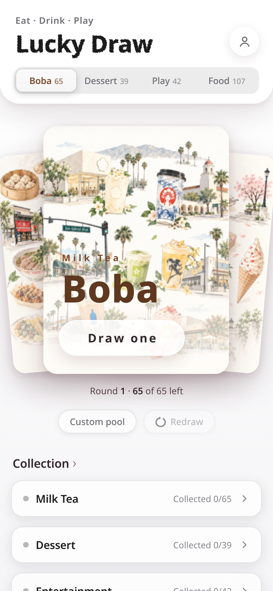
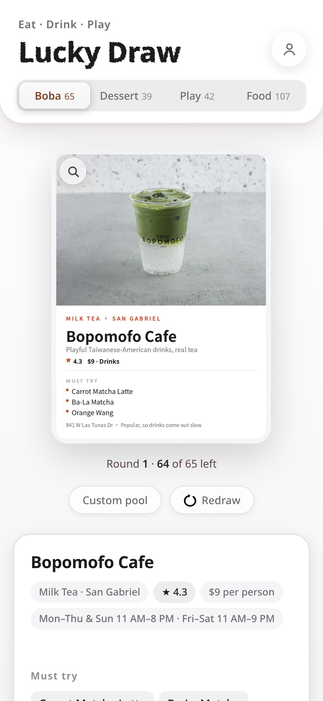
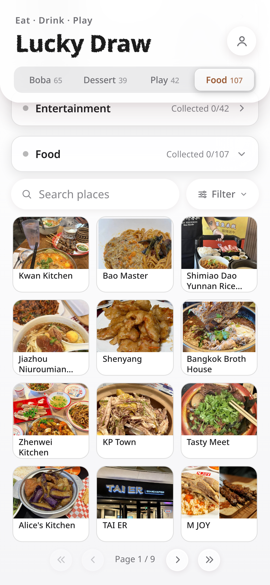
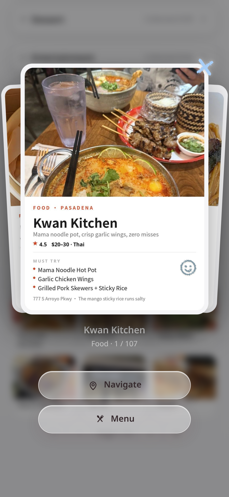
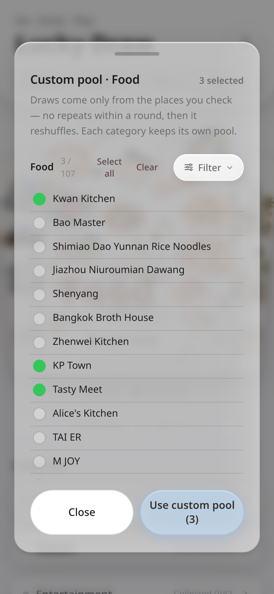
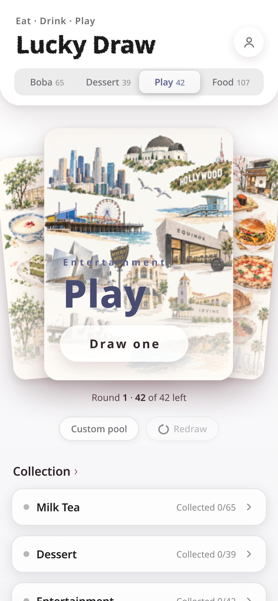

# Lucky Draw — Eat · Drink · Play

**"It's Friday night. Where should we eat?"**

Cue the group chat. *"I dunno." "You pick." "Anything's fine."* (Nothing is fine.)

Lucky Draw ends the debate the fun way — with a deck of cards. Pick a category —
**Boba, Dessert, Food, or Play** — draw one card, and get a hand-picked local spot
with photos, a rating, must-try dishes and the insider tip nobody prints on the menu.
Not feeling it? Redraw. Cards never repeat within a round, so the deck is always
fresh — and the final call is a surprise, never an argument.



**Live production version:** https://eat-drink-play.pages.dev — 253 curated places
across Los Angeles & Orange County, shared by two people on one account.
This repository is the open-source demo edition (12 sample places) of the exact
same app that runs in production.

---

## Why this exists

The problem was never a lack of options. It's the opposite:

- **Saved-post graveyards.** Hundreds of restaurant posts saved on social apps,
  never opened again — while dinner rotates between the same three places.
- **Decision fatigue at the worst moment.** Choosing where to eat happens when
  everyone is already hungry, tired, and in a group chat.
- **Lists don't fix it.** A better list is still a list: someone still has to
  decide, defend the choice, and absorb the blame if it's bad.

The insight: **don't help people choose — remove the choosing.** A deck of cards
is a socially accepted randomizer. Nobody argues with a card. The product is not
a restaurant database with a random button; the *ritual of the draw* is the product.

More on the thinking: [docs/PRODUCT.md](docs/PRODUCT.md) ·
[docs/DESIGN.md](docs/DESIGN.md) · [docs/ARCHITECTURE.md](docs/ARCHITECTURE.md)

## Screenshots

| Draw result | The Collection | Place detail |
|---|---|---|
|  |  |  |

| Custom pool | Not just food — days out too |
|---|---|
|  |  |

## Features

- **Category draw with fair rounds** — draw by Boba / Dessert / Food / Play;
  no repeats within a round, automatic reshuffle, equal odds. Redrawing never
  reshuffles the deck mid-round (a redraw is a second chance, not a new lottery).
- **Custom pools** — build tonight's deck per category with search and filters
  (cuisine, area, price, rating). Pool counts follow the *active filter*, so what
  you see is exactly what you'll draw from.
- **Cards that answer the real questions** — photo, rating, price, hours,
  must-try dishes, one honest caution, address, one-tap directions and the
  actual menu.
- **Two-player ratings** — one shared account, two rating slots (1–5 stars +
  a short note each) and emoji reactions on every card. Taste is negotiated in
  couples; the app is designed for that, not around it.
- **A food diary** — every visit lands on a calendar with both partners' scores;
  draw history and stats keep the places you loved from being forgotten.
- **Fully bilingual** — the entire UI *and* the whole dataset exist in English
  and Chinese; switching languages swaps every place name, dish and tip, and
  even re-renders the card faces in the other language.
- **Local-first PWA** — works offline-ish from the home screen, state on device
  first, account sync when signed in.

## Product decisions worth stealing

- **Curated, not crowdsourced.** Every place is added by hand after checking
  real reviews, the address, hours and rating across sources. A deck you can't
  trust is worse than no deck.
- **The draw is the interface.** Browsing exists (the Collection), but it's the
  supporting act. The home screen is a deck and one button.
- **Restraint as a feature.** No ads, no sponsored rankings, no infinite feed,
  no streaks begging you to return. Open → draw → go eat.

## Tech highlights

- **One self-contained HTML file.** No framework, no build step, no bundler —
  the entire app (UI, state, i18n, sync) is a single file you can read
  top to bottom. View source *is* the documentation.
- **Local-first sync with a paranoid streak.** Ratings write through to the
  database *and* merge by union with tombstones on login, because an early
  version once let an empty device overwrite good data. Saved records are
  sacred; the sync layer is designed around that incident
  (see [docs/ARCHITECTURE.md](docs/ARCHITECTURE.md)).
- **A card factory, not hand-made images.** Every card face is rendered by a
  Python pipeline (`tools/`) from structured data — one accent color, strict
  type hierarchy, a width audit so text can never overflow. English cards use
  an auto-fitting variant so long names never clip.
- **Motion with a budget.** Spring-y, interruptible transitions; the draw
  animation's duration scales with pool size and caps at 8 seconds — long
  enough to feel like fate, short enough to respect hunger.

## Run it locally

```bash
cd app
python3 -m http.server 8000
# open http://localhost:8000
```

That's it — local mode works out of the box. To enable the shared-account sync,
create a Supabase project, run `backend/schema.sql` in its SQL Editor, and
replace `SB_URL` / `SB_ANON_KEY` at the top of the sync section in
`app/index.html` with your own values (see `.env.example` for the shape of
the configuration; the demo intentionally ships placeholders).

## Repository map

```
app/            the whole app — one HTML file + its image assets (12 sample places)
backend/        the Supabase schema (tables, RLS, RPCs, storage) — sanitized, ready to run
data/           places.sample.json — the editorial source data for the samples
tools/          the card-face renderers (Chinese + English auto-fit editions)
docs/           PRODUCT.md · DESIGN.md · ARCHITECTURE.md
screenshots/    the App Store screenshot set
```

## What's intentionally not in this repo

The moat of the production product is the curation, not the code:

- the full **253-place production dataset** (names, notes, tips, ratings) —
  only a 12-place sample is included;
- production **keys, account data and personal records**;
- the bulk image library (sample card faces for the 12 places are included).

Everything else — the complete app, the design system, the card pipeline and
the sync architecture — is here and real.

## License

MIT — see [LICENSE](LICENSE). The sample place data and card artwork are
provided for demonstration; if you build on this, curate your own deck.
